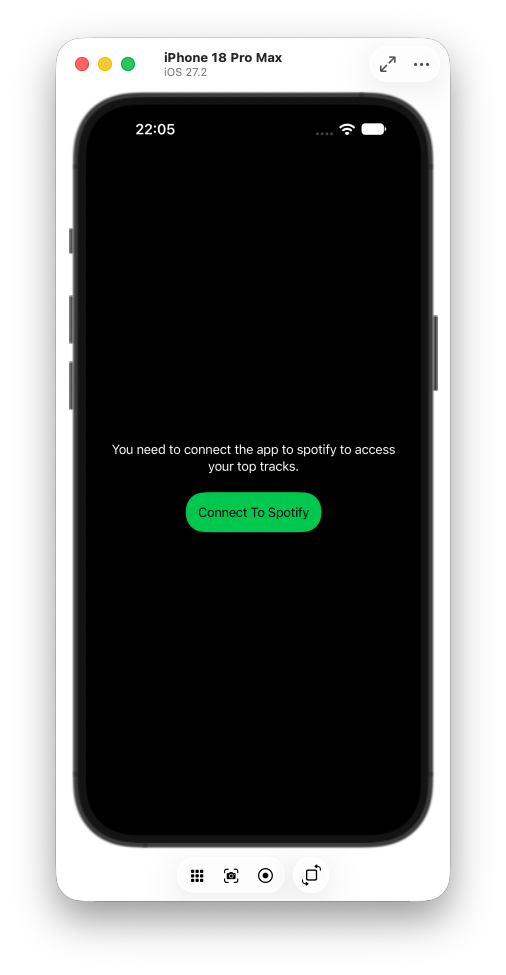
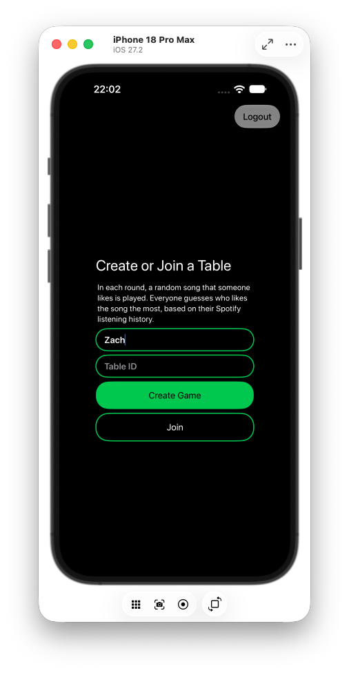
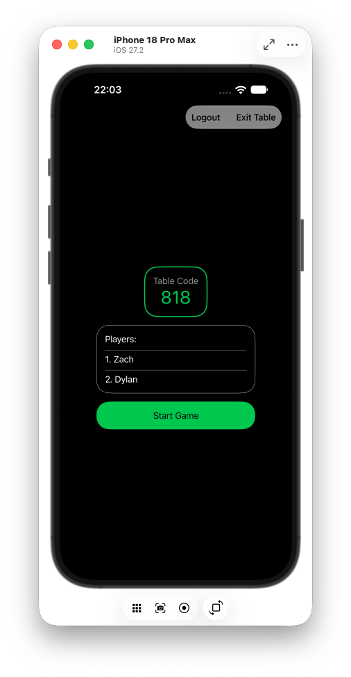
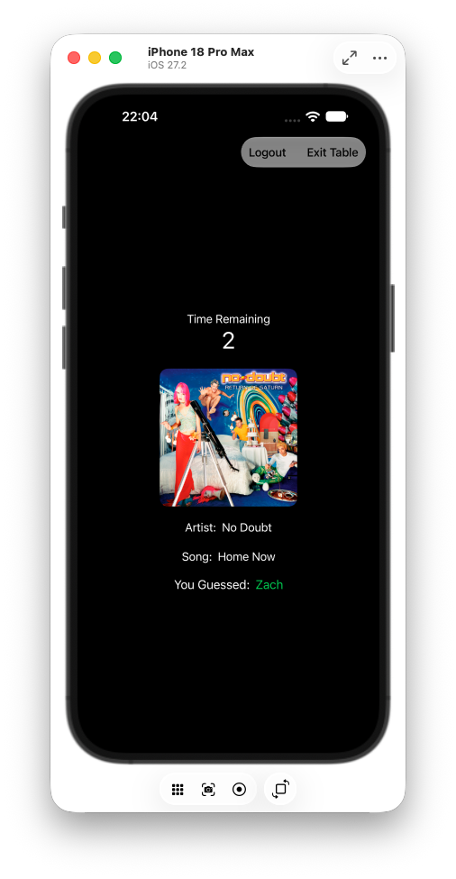
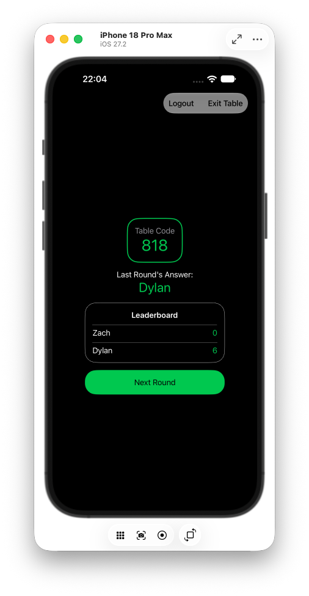

# Spotify Roulette

A multiplayer iOS party game. Everyone connects their Spotify, a song from someone's top tracks plays, and you race to guess whose it is.

| Connect | Join | Lobby | Game | Leaderboard |
|:---:|:---:|:---:|:---:|:---:|
|  |  |  |  |  |

## Features

- **Create or join a table** with a numeric code, then play rounds with friends
- **Timed guessing** — 30 seconds per round, faster correct guesses score more
- **Live leaderboard** after every round

## Technical Overview

- **Spotify OAuth with PKCE** — sign-in runs through `ASWebAuthenticationSession`, with a SHA-256 code challenge and no client secret on the device
- **Token exchange & refresh** — the auth code is exchanged for access/refresh tokens, refreshed automatically with a 60s expiry buffer
- **Secure token storage** — tokens live in the iOS Keychain behind a `TokenStore` actor
- **Spotify Web API** — fetches the player's top tracks (`/v1/me/top/tracks`)
- **iTunes Search API** — Spotify dropped audio previews, so preview clips are looked up on iTunes and played with `AVPlayer`
- **WebSockets** — `URLSessionWebSocketTask` with a typed JSON message protocol (`Codable` enums), a 15s heartbeat, and server-driven game state
- **Config via `.xcconfig`** — client ID, redirect URI and server URL are injected through Info.plist and kept out of git

### Built With
SwiftUI · Swift Concurrency (actors, async/await) · Observation · CryptoKit · Security framework

## Getting Started

### Requirements
- Xcode 26+, iOS 26.2+
- A [Spotify developer app](https://developer.spotify.com/dashboard) with your redirect URI registered
- A running Spotify Roulette game server

### Running the App
1. Create `Config/Debug.xcconfig`:
   ```
   REDIRECT_URI = your-scheme:/$()/callback
   SPOTIFY_CLIENT_ID = your_client_id
   REACT_APP_SERVER_URL = wss:/$()/your-server
   ```
2. Open `Spotify Roulette.xcodeproj` and press **Run** (`Cmd + R`)

## License
All rights reserved.

## Credits
Designed and built by Zachary Upstone, 2026
